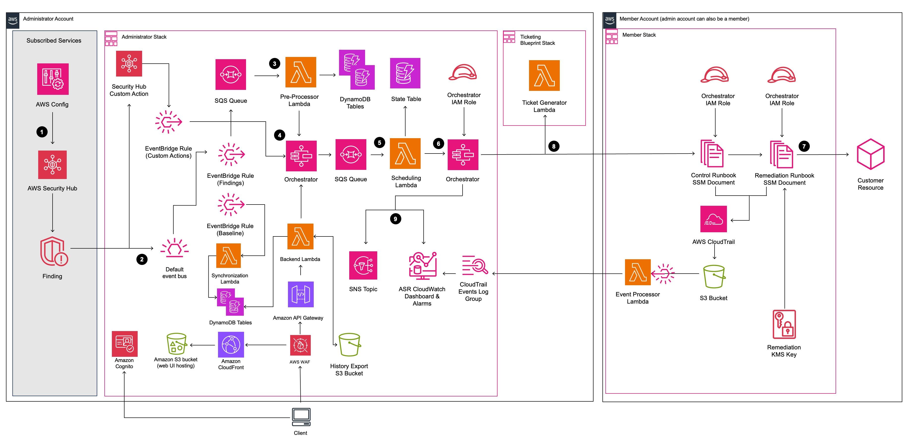

# AWS Self-Healing Security Platform

**Event-Driven Cloud Security Detection, Automated Remediation & Verification**

[](https://www.python.org/)
[](documentation/test_results.json)
[](#project-status)
[](https://aws.amazon.com/)

---

## 1. Project Overview

The AWS Self-Healing Security Platform is an event-driven cloud security automation project designed to detect AWS security misconfigurations, evaluate remediation policies, execute authorized corrective actions, and verify the resulting security posture.

The platform aims to reduce manual security intervention through controlled, policy-driven remediation while maintaining accountability, auditability, and operational safety.

The initial implementation focuses on securing Amazon S3 buckets against unintended public access.

The repository also includes DevDoc, a local documentation assistant that reviews Git changes, filters project context, and returns drafts for human review. DevDoc does not publish or save drafts automatically. Its separate AI security controls and limitations are documented in [DevDoc AI Security Controls](docs/devdoc-security.md).

**Development approach:** Local-first implementation using Python, automated tests, and mocked AWS interactions before live AWS integration.

## 2. Project Objectives

- Detect AWS security misconfigurations.
- Validate incoming security events.
- Enforce resource-specific remediation policies.
- Prevent unauthorized remediation.
- Execute approved security remediation.
- Prevent harmful duplicate event processing.
- Verify remediation outcomes.
- Maintain structured audit records.
- Monitor security operations through metrics.
- Support controlled recovery from processing failures.

## 3. System Architecture

### 3.1 Current Implementation Architecture

The current implementation is developed and tested locally using Python and mocked AWS interactions.

**Core processing workflow:**

1. Receive a security event.
2. Validate the event structure and identifiers.
3. Check event idempotency and processing ownership.
4. Evaluate remediation authorization policies.
5. Execute the approved remediation workflow.
6. Verify the remediation result.
7. Record structured audit information and operational metrics.

### 3.2 Target AWS Architecture

**AWS Config → Amazon EventBridge → AWS Lambda → Policy Evaluation → S3 Remediation → Verification → Audit & Monitoring**

| Technology | Responsibility |
|---|---|
| AWS Config | Security compliance detection |
| Amazon EventBridge | Security event routing |
| AWS Lambda | Event processing and orchestration |
| AWS IAM | Access control and permissions |
| Amazon S3 | Resource remediation and audit evidence storage |
| Amazon CloudWatch | Monitoring, logs and metrics |
| Python | Security automation and remediation logic |
| Terraform | Infrastructure as Code |

*This describes the intended AWS deployment architecture. Live AWS integration and deployment are separate milestones.*

### 3.3 Reference Multi-Account Architecture

The following diagram is maintained as a reference for broader AWS security automation, centralized orchestration, and multi-account architecture planning.



The reference diagram illustrates additional AWS services and workflows, including:

- AWS Security Hub
- Amazon SQS
- Amazon DynamoDB
- AWS Systems Manager
- AWS Step Functions
- Amazon SNS
- Amazon API Gateway
- AWS CloudTrail
- AWS KMS
- Amazon CloudFront
- AWS WAF
- Amazon Cognito

**Important:** This is a reference architecture, not the current deployed architecture of this project.

See [Architecture Documentation](architecture/architecture.md) for implementation details and reference design information.

## 4. Implemented Components

The following components have been implemented and developed with local automated testing:

| Component | Implementation |
|---|---|
| Event Validator | Validates incoming AWS Config events |
| Policy Engine | Enforces resource allowlists and remediation authorization |
| S3 Remediation Engine | Implements controlled S3 remediation logic |
| Verification Engine | Checks remediation outcomes |
| Centralized Orchestrator | Coordinates the remediation workflow |
| Idempotency Manager | Prevents duplicate event processing |
| Lease-Based Processing | Manages event ownership and stale-event recovery |
| Audit Logger | Generates structured audit records |
| Metrics Module | Records security operation metrics |
| Error Handler | Centralizes workflow error handling |

## 5. Security Controls

- Fail-closed remediation authorization.
- Explicit resource allowlisting.
- Event source and event-type validation.
- Required-field validation.
- Event identifier validation.
- Rejection of malformed event identifiers.
- Duplicate event protection.
- Lease-based event ownership.
- Dry-run execution enabled by default.
- Post-remediation verification.
- Structured audit logging.
- Centralized error handling.

Additional adversarial testing and resource validation are ongoing.

## 6. Testing & Validation

The platform uses Python unit tests and mocked AWS responses during local development.

### 6.1 Latest Verified Test Results

| Metric | Result |
|---|---:|
| Tests passed | 282 |
| Subtests passed | 9 |
| Test failures | 0 |
| Test framework | pytest |
| Execution environment | Repository Python virtual environment |
| Skipped tests | 0 |

Command: `python -m pytest -v --tb=short`

Detailed machine-readable results: [`documentation/test_results.json`](documentation/test_results.json).

### 6.2 Historical Test Execution Evidence

The screenshot in `screenshots/` records an earlier 91-test run from 19 November 2026. It is retained as historical evidence and does not represent the latest test result.

See the [Screenshots & Evidence](screenshots/README.md) directory for additional implementation and testing evidence.

**Testing qualification:** These results demonstrate local automated testing. They do not establish live AWS deployment or successful execution against real AWS resources.

## 7. Technology Stack

| Technology | Purpose |
|---|---|
| Python | Security automation |
| pytest | Automated testing |
| AWS Config | Configuration compliance |
| Amazon EventBridge | Event-driven architecture |
| AWS Lambda | Serverless execution |
| Amazon S3 | Storage and remediation target |
| AWS IAM | Identity and access management |
| Amazon CloudWatch | Monitoring and metrics |
| Terraform | Infrastructure as Code |
| Git & GitHub | Version control and project documentation |

## 8. Development Roadmap

### Completed

- [x] Core repository and project structure
- [x] Event validation
- [x] Remediation policy engine
- [x] S3 remediation logic
- [x] Verification engine
- [x] Centralized orchestration
- [x] Structured audit logging
- [x] Security metrics integration
- [x] Centralized error handling
- [x] Idempotency management
- [x] Lease-based event processing
- [x] Local automated test coverage
- [x] Event identifier security validation
- [x] Non-string event identifier rejection
- [x] Initial test execution evidence
- [x] Documentation automation tools and validation tests
- [x] DevDoc AI outbound security hardening

### In Progress / Planned

- [ ] DevDoc prompt-injection testing for untrusted project-file content
- [ ] Additional AWS adversarial security testing
- [ ] Enhanced S3 resource identifier validation
- [ ] AWS region validation
- [ ] Further orchestrator security testing
- [x] Update and validate security documentation and threat model (22 November 2026)
- [ ] AWS infrastructure implementation
- [ ] Least-privilege IAM policy design and review
- [ ] Isolated AWS integration testing
- [ ] Terraform deployment
- [ ] End-to-end AWS remediation testing
- [ ] Multi-account architecture evaluation

## 9. Project Safety & Deployment

The current development environment prioritizes local testing and mocked AWS interactions.

Before live deployment:

- Use isolated AWS test resources.
- Apply least-privilege IAM permissions.
- Review all remediation permissions.
- Keep production resources outside the remediation allowlist.
- Review AWS costs before deployment.
- Verify remediation behavior before enabling automated actions.
- Never commit AWS credentials, access keys, or secrets.
- Document resource cleanup procedures.

**Live AWS remediation is not claimed by the current local test results.**

## 10. Repository Structure

```text
AWS-self-healing-security-platform/
+-- architecture/              Current and reference AWS architecture
+-- docs/                      AWS security docs, DevDoc security, checkpoint
+-- documentation/             Project status and verified test report
+-- lambda/remediation_engine/  AWS remediation application modules
+-- policies/                  Reserved for future policy definitions
+-- scripts/
|   +-- devdoc/                 Documentation assistant
|   +-- generate_docs.py        Markdown inventory generator
|   +-- validate_docs.py        Documentation consistency checks
|   +-- update_test_results.py  Full test report updater
+-- terraform/                 Reserved for future deployment configuration
+-- tests/                     AWS, DevDoc, and documentation-tool tests
+-- PROJECT_STATUS.md
+-- README.md
```

## 11. Project Status

**Status:** Under Development — Local implementation and automated testing.

**AWS deployment:** Pending isolated AWS integration and deployment testing.

**Architecture:** Current implementation and broader reference architecture documented separately.

## 12. Disclaimer

This is an educational cloud security engineering project.

All testing and deployment must be performed in AWS accounts and environments owned by the developer or explicitly authorized for assessment.

---

**Author:** BlueBoyx023

**Project Focus:** AWS Security Engineering | Cloud Security Automation | Security Remediation | Autonomous Cloud Defense
