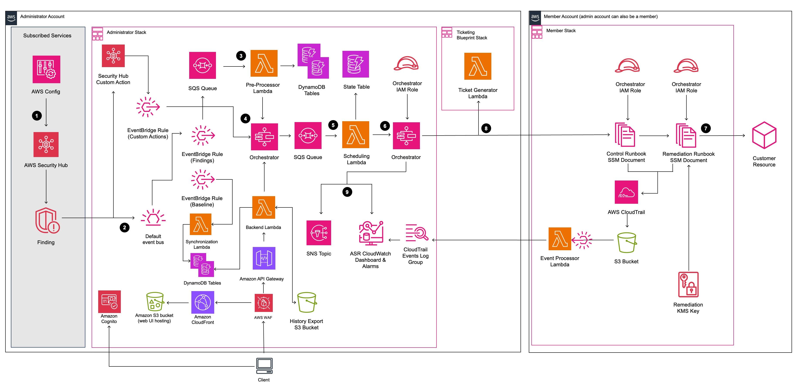

# System Architecture

## 1. Project Overview

The AWS Self-Healing Security Platform is an event-driven cloud security automation project designed to detect security misconfigurations, evaluate remediation policies, execute authorized remediation, and verify outcomes.

## 2. Current Implementation Architecture

The current implementation is developed and tested locally using Python and mocked AWS interactions.

### Processing Workflow

1. Receive a security event.
2. Validate the event structure and identifiers.
3. Check event idempotency and processing ownership.
4. Evaluate remediation authorization policies.
5. Execute the approved remediation workflow.
6. Verify the remediation result.
7. Record structured audit information and operational metrics.

### Implemented Components

- Event Validator
- Policy Engine
- S3 Remediation Engine
- Verification Engine
- Centralized Orchestrator
- Idempotency Manager
- Lease-Based Event Processing
- Audit Logger
- Metrics Module
- Centralized Error Handler

**Deployment status:** Local implementation and automated testing. Live AWS deployment is not yet established.

## 3. Target AWS Architecture

The intended AWS deployment uses:

- AWS Config for compliance detection.
- Amazon EventBridge for event routing.
- AWS Lambda for processing and remediation.
- AWS IAM for access control.
- Amazon S3 for resource remediation and evidence storage.
- Amazon CloudWatch for monitoring.

This is the target deployment architecture, not a claim that these services are currently deployed.

## 4. Reference Multi-Account Architecture

The following diagram is maintained as a reference for broader AWS security automation and multi-account architecture planning.

The diagram illustrates additional AWS services and workflows, including:

- AWS Security Hub
- Amazon SQS
- Amazon DynamoDB
- AWS Systems Manager
- AWS Step Functions
- Amazon SNS
- Amazon API Gateway
- AWS CloudTrail
- AWS KMS
- Amazon CloudFront
- AWS WAF
- Amazon Cognito

These services are reference design elements. Their appearance in this diagram does not indicate implementation in the current project.

## 5. Architecture Evolution

Future architecture development may consider:

- Multi-account security event aggregation.
- Centralized security orchestration.
- Queue-based event processing.
- Distributed workflow coordination.
- Human approval for high-impact remediation.
- Centralized audit and monitoring.

## 6. Architecture Status

| Architecture | Status |
|---|---|
| Local Python remediation workflow | Implemented |
| Automated local testing | Implemented |
| Target AWS deployment | Planned |
| Multi-account reference design | Documented reference |
| Live AWS integration | Pending |
