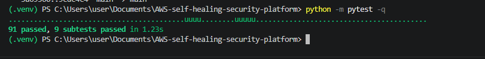

# Screenshots & Evidence

## Purpose

This directory stores screenshots and visual evidence demonstrating the implementation, testing, and development progress of the AWS Self-Healing Security Platform.

## 1. Local Test Execution Evidence

### Latest Verified Test Results

**Test results:**
- 91 tests passed
- 9 subtests passed
- Execution time: 1.23 seconds
- Environment: Local Python virtual environment
- Test framework: pytest

**Evidence type:** Local automated testing. This is not evidence of live AWS execution.

## 2. Planned Evidence

The following evidence will be added as development progresses:

- AWS Config compliance findings
- EventBridge event delivery
- Lambda execution results
- Security remediation actions
- Post-remediation verification
- CloudWatch logs and metrics
- Additional adversarial security test results
- System architecture and workflow diagrams

## 3. Evidence Requirements

- Capture genuine AWS console or terminal output.
- Avoid exposing AWS account IDs, credentials, or sensitive information.
- Include context and descriptions for each screenshot.
- Never present simulated output as real AWS execution evidence.
- Preserve historical test evidence when new milestones are reached.

## 4. Development Status

**Local testing evidence:** Available.

**AWS integration evidence:** Pending isolated AWS integration testing.

**Security implementation evidence:** Being added incrementally.
